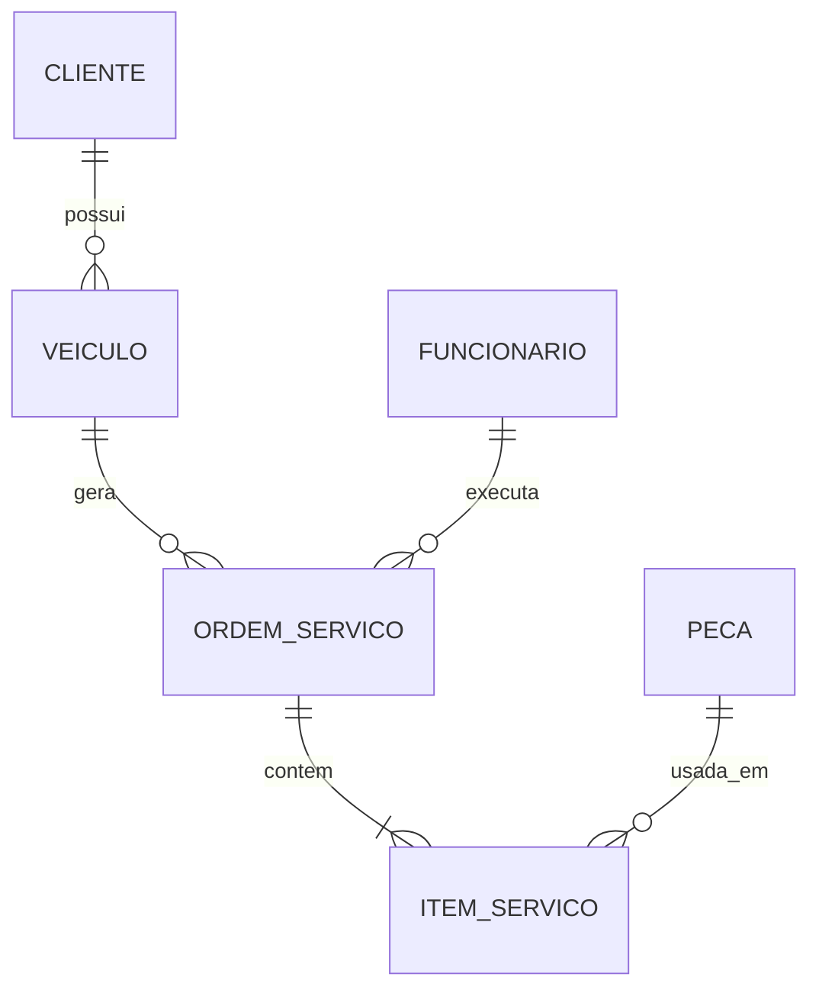

<!-- ============================================================
  README de perfil — Lipe0921
  Como usar: crie um repositório PÚBLICO chamado exatamente "Lipe0921"
  (mesmo nome do seu usuário) e coloque este arquivo na raiz.
  Procure por "EDITE" para trocar o que for seu.
============================================================ -->

<!-- ░░░░░░░░░░░░ HEADER ANIMADO ░░░░░░░░░░░░ -->
<div align="center">


<a href="https://github.com/Lipe0921">
  
</a>

<br/>


</div>

<br/>

<!-- ░░░░░░░░░░░░ NAVEGAÇÃO CLICÁVEL ░░░░░░░░░░░░ -->
<div align="center">

[**🧑‍💻 Sobre**](#-sobre-mim) •
[**🧰 Stack**](#-stack) •
[**🚀 Projetos**](#-projetos-em-destaque) •
[**📊 Stats**](#-estatísticas) •
[**🐍 Snake**](#-minha-contribuição-virou-um-jogo) •
[**🏆 Troféus**](#-troféus) •
[**📫 Contato**](#-bora-conversar)

</div>

---

## 🧑‍💻 Sobre mim

<table>
<tr>
<td width="60%" valign="top">

```js
const lipe = {
  usuario: "Lipe0921",
  cidade: "São Paulo, Brasil 🇧🇷",          // EDITE
  foco: ["Modelagem de dados", "Banco de dados", "ERP", "Back-end"],
  aprendendoAgora: ["SQL avançado", "Git/GitHub", "Arquitetura de sistemas"], // EDITE
  superpoder: "Transformar bagunça em estrutura 🧩",
  combustivel: "☕ + música alta",
  pergunteMeSobre: ["DER", "normalização", "projetos integradores"],
  funFact: "Meu DER já foi refeito mais vezes que meu café esfriou ☕",
};
```

</td>
<td width="40%" align="center" valign="middle">


</td>
</tr>
</table>

<details>
<summary><b>🎲 Clique aqui: 3 coisas que você não sabia sobre mim</b></summary>
<br/>

1. 🧠 Gosto mais de entender **por que** o sistema é assim do que de só fazer ele funcionar.
2. 🛠️ Acredito que um bom modelo de dados evita 80% das dores de cabeça futuras.
3. 🎮 *(EDITE: coloque aqui um hobby seu, joguinho favorito, time, série...)*

</details>

<details>
<summary><b>🔮 Clique: o que eu seria no mundo dos bancos de dados?</b></summary>
<br/>

> Uma **chave estrangeira**: sempre conectando as pessoas certas. 🔗

</details>

---

## 🧰 Stack

<div align="center">

**Linguagens & Dados**


**Ferramentas**


<!-- EDITE: remova o que você não usa e adicione outros ícones: https://skillicons.dev -->

</div>

<details>
<summary><b>🏷️ Ver em formato de badges</b></summary>
<br/>

<div align="center">


</div>

</details>

---

## 🚀 Projetos em destaque

<div align="center">

<a href="https://github.com/Lipe0921/projeto-funilaria">
  
</a>

<!-- EDITE: duplique o bloco acima com outros repositórios seus -->

</div>

### 🔧 Prime Funilaria — ERP

Projeto integrador de modelagem de dados: um ERP pensado do zero para uma funilaria, com **DER**, **dicionário de dados** e documentação completa.



> 💡 *Diagrama ilustrativo, o GitHub renderiza Mermaid direto no README. Ajuste as entidades para bater com o seu DER real.*

<details>
<summary><b>📂 Ver estrutura do projeto</b></summary>

```text
projeto-funilaria/
├── README.md
├── DER/
├── dicionario-de-dados/
└── scripts-sql/
```

</details>

---

## 📊 Estatísticas

<div align="center">


<br/><br/>


</div>

---

## 🐍 Minha contribuição virou um jogo

<div align="center">

<!-- Precisa do workflow snake.yml (vem junto, em .github/workflows/) -->
<picture>
  <source media="(prefers-color-scheme: dark)" srcset="https://raw.githubusercontent.com/Lipe0921/Lipe0921/output/github-snake-dark.svg" />
  <source media="(prefers-color-scheme: light)" srcset="https://raw.githubusercontent.com/Lipe0921/Lipe0921/output/github-snake.svg" />
  
</picture>

</div>

---

## 🏆 Troféus

<div align="center">


</div>

---

## 🎯 Meta do momento

<div align="center">

| Objetivo | Progresso |
|:--|:--|
| 🗄️ Dominar modelagem de dados |  |
| 🧪 Praticar SQL todo dia |  |
| 🌱 Contribuir em open source |  |

<sub>EDITE os números conforme você evolui, é só mudar o valor depois de /progress/</sub>

</div>

---

## 💬 Frase do dia

<div align="center">


</div>

---

## 📫 Bora conversar

<div align="center">

<a href="https://github.com/Lipe0921"></a>
<a href="https://www.linkedin.com/in/SEU-USUARIO"></a>
<a href="mailto:seuemail@exemplo.com"></a>

<!-- EDITE: LinkedIn e e-mail acima -->

<br/><br/>

<sub>⭐ Gostou do perfil? Deixa uma estrela em algum repo, ela alimenta meu café. ☕</sub>

</div>


